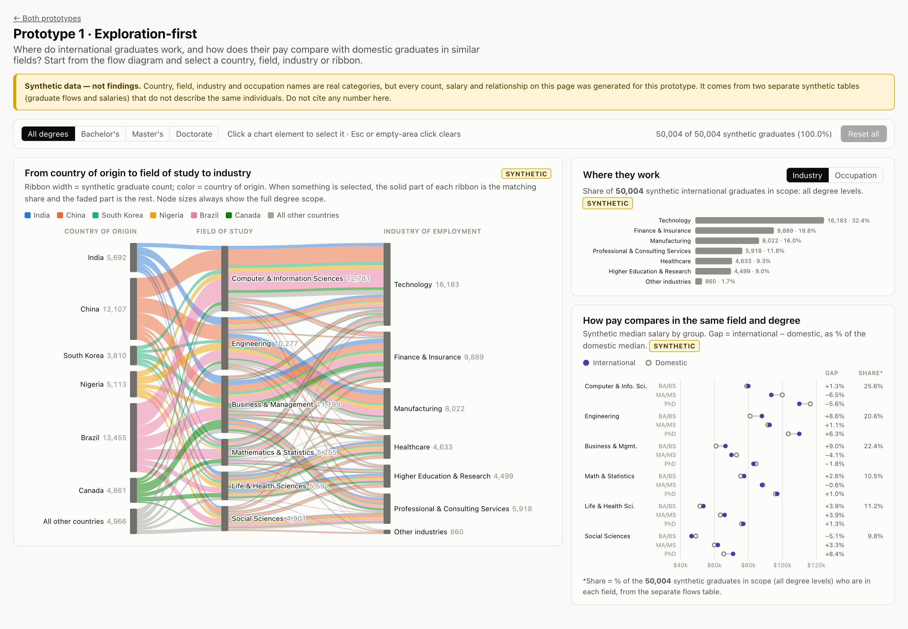
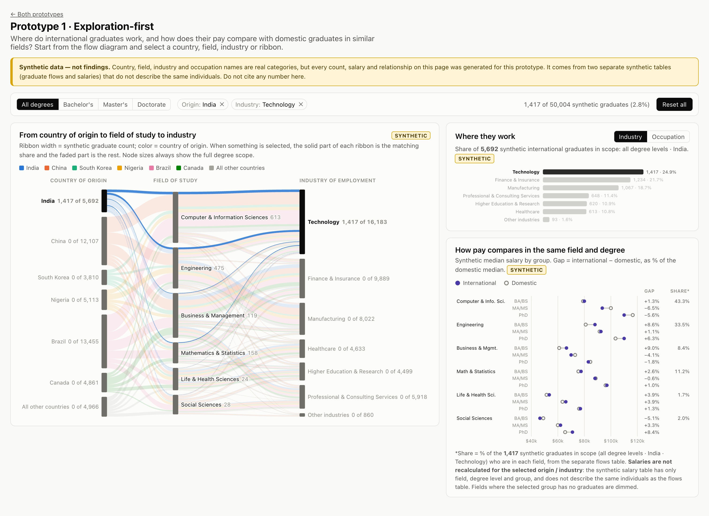
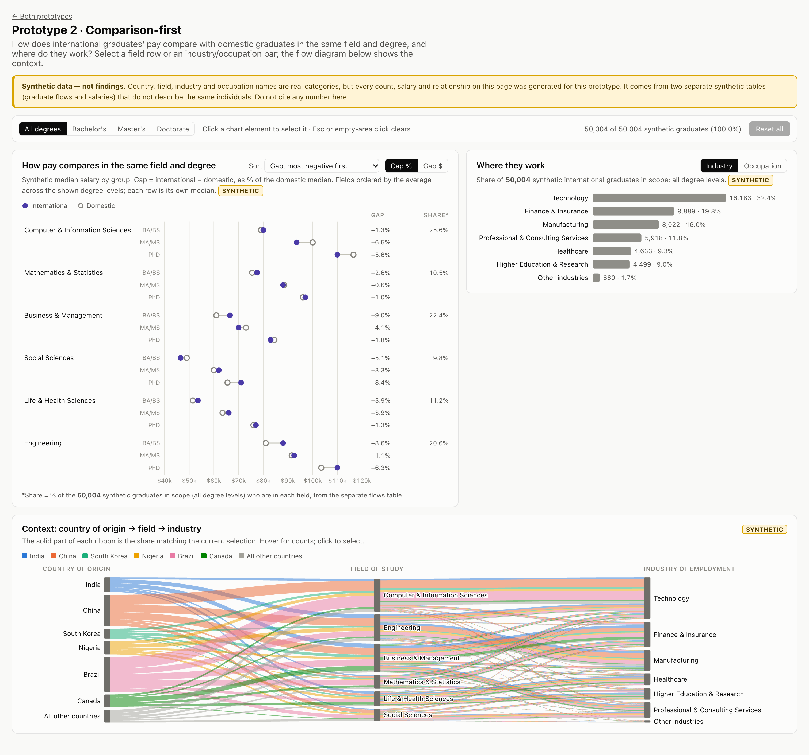
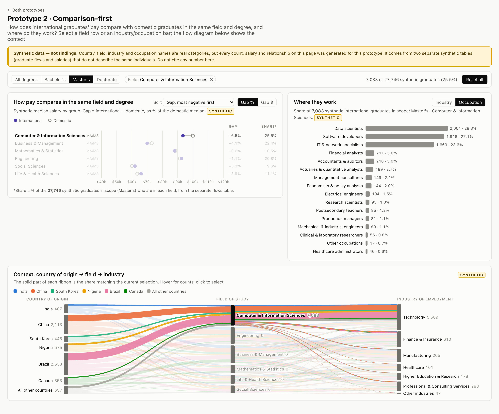

# International Graduates: Coordinated-View Dashboard Prototypes

CS 1710 (Data Visualization) milestone: two interactive mini-dashboards that explore coordinated views for a policymaker audience. The guiding question is:

> **Where do international graduates work, and how does their pay compare with domestic graduates in similar fields?**

| | Live URL (after deployment) |
|---|---|
| Landing page | https://santinomarial.github.io/CS1710-Dashboard-Prototypes/ |
| Prototype 1 · Exploration-first | https://santinomarial.github.io/CS1710-Dashboard-Prototypes/prototype-1/ |
| Prototype 2 · Comparison-first | https://santinomarial.github.io/CS1710-Dashboard-Prototypes/prototype-2/ |

> [!WARNING]
> **All data in this project is synthetic.** Country, field, industry and occupation names are real categories. Every count, salary and relationship is generated by [`data/generate_synthetic.js`](data/generate_synthetic.js) and is **not** an empirical finding. Do not cite any number from these dashboards. See [Data and limitations](#data-and-limitations).

## The two prototypes

Both prototypes use the same three linked views:

1. **Parallel-sets flow diagram:** country of origin → field of study → industry of employment
2. **Employment bar chart:** where graduates work, switchable between **industry** and **occupation**
3. **Salary dumbbell chart:** international vs. domestic synthetic median salary within the same field and degree level

### Prototype 1 · Exploration-first

The flow diagram is the main view. You start from where graduates come from and follow them through field and industry. The employment and salary charts sit beside it and respond to every selection.

| Default | Linked selection: India + Technology |
|---|---|
|  |  |

In the linked state, India's ribbons stay solid while everything else fades. Node labels switch to "matched of total" (e.g. *Technology 1,417 of 16,183*), the bars recount for India, and the salary chart explains why its values do not change.

### Prototype 2 · Comparison-first

The salary comparison and employment chart lead, with sort (by gap, by domestic median, or fixed order) and gap-unit (% / $) controls. A compact flow diagram underneath gives context.

| Default | Linked selection: Master's + Computer & Information Sciences, occupation view |
|---|---|
|  |  |

## Interactions

| Action | Effect |
|---|---|
| Click a flow node, ribbon, bar or salary row | Selects it; all three views update. Click again to deselect. |
| Click a ribbon | Selects the pair it connects (country + field, or field + industry) |
| Degree buttons | Scope every view to one degree level |
| Industry / Occupation toggle | Switches the employment chart. Selecting an occupation also selects its industry. |
| Hover | Tooltip with counts and denominators, labelled "Synthetic · illustrative only" with its source table |
| **Reset** | "Reset all" button · ✕ on a single chip · `Esc` · click an empty chart area (keeps the degree level) |

### What each selection can and cannot change

The two synthetic tables have different columns, so the views only recompute what the data supports:

| Selection | Flow diagram | Employment bars | Salary dumbbell |
|---|---|---|---|
| Degree level | Relaid out for that level | Recounted | Shows only that level's rows |
| Country of origin | Matching share drawn solid | Recounted | **Salaries unchanged.** The Share column is recounted and fields with no matching graduates are dimmed |
| Field | Matching share drawn solid | Recounted | That field emphasized |
| Industry / occupation | Matching share drawn solid | Selected bar emphasized | **Salaries unchanged.** Share column recounted, fields with none dimmed |

Each chart keeps all of its own categories visible and highlights the selected one rather than filtering itself. Every percentage states its denominator.

## Data and limitations

Two **independent** synthetic tables live in `static/data/`. The full data dictionary is in [`data/DATA_README.md`](data/DATA_README.md).

- **`flows_synthetic.csv`:** synthetic headcounts by origin × degree × field × industry × occupation (50,004 synthetic graduates in total). Every occupation belongs to exactly one industry.
- **`salaries_synthetic.csv`:** synthetic median salary by field × degree × group (international / domestic).

Limitations:

- **Not real data.** The field→industry weights were hand-picked only so that selections visibly change the views. The sign and size of every salary gap is random.
- **The tables do not describe the same individuals.** They share only the category labels for field and degree level. No salary can be attributed to an origin, industry or occupation, so the dashboards never compute one.
- **Medians are never combined.** No salary is averaged across degree levels or fields. Sorting by an average only sets the row order.
- **No time dimension, sample sizes or uncertainty.**
- Candidate real sources for a future version, still to be verified, are listed in `data/DATA_README.md`. As far as we know, no public source links origin → field → industry for the same people.

## Run locally

Requires Node.js 20.19+ or 22.12+.

```sh
npm install
npm run dev          # open the printed URL (http://localhost:5173/)
```

Other scripts:

```sh
npm run build                                          # static site in build/
npm run preview                                        # serve that build locally
BASE_PATH=/CS1710-Dashboard-Prototypes npm run build   # build exactly as GitHub Pages does
npm run generate-data                                  # regenerate the synthetic CSVs (seeded: identical output)
```

## Deployment

Pushing to `main` runs [`.github/workflows/deploy.yml`](.github/workflows/deploy.yml). It builds the site with `BASE_PATH=/<repository-name>` and publishes `build/` to GitHub Pages.

- `@sveltejs/adapter-static` prerenders `/`, `/prototype-1/` and `/prototype-2/` as separate HTML files, so each prototype has its own URL that works when opened directly.
- Data URLs use `asset()` and links use `resolve()` from `$app/paths`, so they follow the base path.
- `static/.nojekyll` stops GitHub Pages from hiding SvelteKit's `_app/` folder.

If you rename the repository, the workflow picks up the new name automatically. Only the URLs in this README need updating.

## Project structure

```
src/
  routes/
    +layout.js                 prerender + trailing-slash config
    +page.svelte               landing page
    prototype-1/+page.svelte   exploration-first layout
    prototype-2/+page.svelte   comparison-first layout
  lib/
    FlowDiagram.svelte         parallel sets (hand-built with D3)
    EmploymentBars.svelte      industry / occupation bars
    SalaryDumbbell.svelte      international vs. domestic salary
    selection.svelte.js        per-page linked-selection state
    data.js                    categories, loading, formatting
    SelectionBar.svelte, Tooltip.svelte, DataNotice.svelte, OriginLegend.svelte, usePage.svelte.js
static/data/                   the two synthetic CSVs
data/                          generator + data dictionary
screenshots/                   default and linked states of both prototypes
```

Built with SvelteKit, Svelte 5 and D3.
